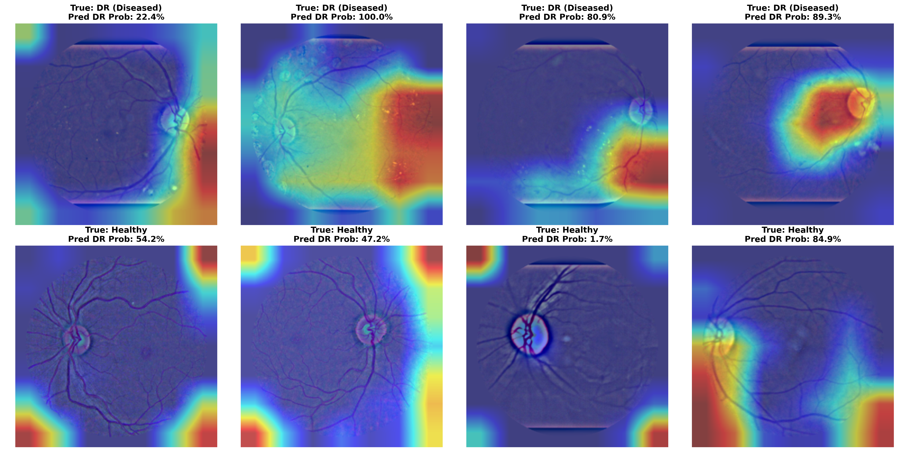
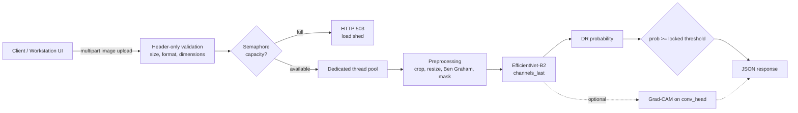

<div align="center">

# ARTSS — Ophthalmic Diabetic Retinopathy Screening System

**Automated Diabetic Retinopathy (DR) screening from color retinal fundus photographs, served as a hardened clinical decision-support microservice.**


</div>

---

## Table of Contents

1. [Overview](#overview)
2. [Key Engineering Highlights](#key-engineering-highlights)
3. [Clinical Validation Results](#clinical-validation-results)
4. [System Architecture](#system-architecture)
5. [Methodology](#methodology)
6. [Explainability (Grad-CAM)](#explainability-grad-cam)
7. [Service Design & Hardening](#service-design--hardening)
8. [Repository Structure](#repository-structure)
9. [Getting Started](#getting-started)
10. [Reproducing the Results](#reproducing-the-results)
11. [Limitations & Intended Use](#limitations--intended-use)
12. [Future Work](#future-work)
13. [References](#references)
14. [Author](#author)
15. [Disclaimer](#disclaimer)

---

## Overview

Diabetic Retinopathy is a leading cause of preventable vision loss, and screening at scale is limited by the number of trained graders. **ARTSS** (Autonomous Retinal Triage & Screening System) takes a single color fundus photograph and returns:

- a calibrated **DR probability**,
- a **binary screening decision** (DR present / not present) at a clinically motivated operating threshold, and
- an optional **Grad-CAM saliency overlay** showing which retinal regions drove the prediction.

The project covers the full lifecycle: patient-grouped training on a public dataset, threshold selection on a held-out validation split, **zero-shot evaluation on independent external cohorts**, and deployment as a containerizable FastAPI service with a browser-based screening workstation.

> The task is formulated as binary screening: **DR grade 0 → negative**, **grade 1–4 → positive**.

---

## Key Engineering Highlights

- **Zero train/serve skew.**
  Preprocessing parameters (`stored_size=512`, `image_size=224`, `border_thresh=10`, `sigma_ratio=1/30`, `mask_ratio=0.9`) and the Youden-calibrated operating threshold (`0.4761`) are loaded at startup from training artifacts (`dr_efficientnet_b2_224_results.json` and `preprocess_config.json`) instead of being hard-coded in the server. An automated `--parity-check` CLI mode compares the training and serving pipelines and enforces **0 max pixel divergence**.

- **Multi-hospital, zero-shot generalization.**
  Trained only on **ODIR-5K** with patient-level group splitting (`GroupShuffleSplit`) to prevent patient leakage, then evaluated with no fine-tuning on two independent cohorts: **APTOS-2019** (AUROC **0.8548**) and **IDRiD** (AUROC **0.8754**).

- **Leak-free Grad-CAM explainability.**
  Real-time `conv_head` activation overlays are rendered on the natural-color retinal image, and PyTorch forward/backward hooks are explicitly released (`cam.activations_and_grads.release()`) after every inference pass so that long-running workers do not accumulate hooks or memory.

- **Hardened asynchronous FastAPI service.**
  Header-only pre-validation guards against decompression bombs, an `asyncio.Semaphore` provides bounded load-shedding (`HTTP 503` when saturated), inference runs in a dedicated thread pool using the `torch.channels_last` memory format, and patient-identifying filenames are stripped from request logs.

- **Reproducible, auditable evaluation.**
  The external-cohort evaluator (`eval_idrid.py`) reports bootstrap and Wilson 95% confidence intervals, resolves train/test filename collisions safely, records every skipped image with a reason, and saves per-image predictions for audit.

---

## Clinical Validation Results

The model (`dr_efficientnet_b2_224@93d017f472c3`) was trained on **ODIR-5K** (`n = 4,564` training images) using EMA weight averaging (`decay = 0.998`), cosine annealing with linear warmup, and positive-class weighting (`pos_weight = 2.976`). The diagnostic operating threshold (**`0.4761`**) was selected **only on the ODIR validation split** via Youden's $J$ statistic ($J = \text{sensitivity} + \text{specificity} - 1$) and **locked before any test evaluation**.

| Dataset / Cohort | Evaluation Role | Images ($N$) | DR Positive Rate | AUROC (95% CI) | AUPRC | Sensitivity (@ 0.4761) | Specificity (@ 0.4761) |
| :--- | :--- | :---: | :---: | :---: | :---: | :---: | :---: |
| **ODIR-5K** | Validation | 914 | 25.16% | **0.8075** `[0.776, 0.839]` | 0.6655 | 70.9% | 77.5% |
| **ODIR-5K** | Internal Test | 914 | 25.16% | **0.7840** `[0.747, 0.819]` | 0.6032 | 60.9% | 79.1% |
| **APTOS-2019** | External Test 1 (Zero-Shot) | 3,530 | 49.12% | **0.8548** `[0.842, 0.867]` | 0.8846 | 76.5% | 80.4% |
| **IDRiD** | External Test 2 (Zero-Shot) | 455 | 71.65% | **0.8754** `[0.841, 0.907]` | 0.9479 | 96.3% | 33.3% |

### How to read these results

- **Ranking quality transfers across hospitals.** External AUROC (0.85–0.88) is at least as high as internal AUROC (0.78–0.81), which suggests the model learned DR-relevant features rather than dataset-specific artifacts. External cohorts have a higher proportion of moderate-to-severe disease, which generally makes the positive class easier to separate.
- **The operating point does not transfer equally well.** On IDRiD the fixed threshold gives very high sensitivity (96.3%) but low specificity (33.3%). This is a threshold/prevalence effect rather than a ranking failure: the cohort's positive rate (71.65%) and its camera and grading conditions differ markedly from ODIR's (25.16%). **Any real deployment should recalibrate the threshold on a local validation sample** from the target site.
- **Metrics are cohort-specific.** AUPRC depends on prevalence, so it should not be compared directly across rows.

<div align="center">

<br/><em>Grad-CAM overlays: warmer regions indicate stronger contribution to the DR probability.</em>
</div>

---

## System Architecture



Training artifacts (`*_results.json`, `preprocess_config.json`, `*_best.pth`) are the **single source of truth** for both training and serving.

---

## Methodology

### 1. Data and splitting

| Cohort | Role | Notes |
| :--- | :--- | :--- |
| ODIR-5K | Train / validation / internal test | Patient-level `GroupShuffleSplit` so that both eyes of a patient never straddle splits |
| APTOS-2019 | External test (zero-shot) | Never used for training, tuning, or threshold selection |
| IDRiD | External test (zero-shot) | Never used for training, tuning, or threshold selection |

All cohorts are mapped to the same binary target (**grade 0 → negative, grade ≥ 1 → positive**).

### 2. Preprocessing

Fundus photographs vary widely in camera, illumination, and field of view. The pipeline normalizes these differences using **Ben Graham local color subtraction**, which removes low-frequency illumination so that lesions (microaneurysms, hemorrhages, exudates) stand out. Parameters are stored in `preprocess_config.json` and loaded by both the trainer and the server.

| Parameter | Value | Role |
| :--- | :---: | :--- |
| `stored_size` | `512` | Resolution at which preprocessed images are stored / processed |
| `image_size` | `224` | Network input resolution |
| `border_thresh` | `10` | Intensity threshold used to crop the black border around the retina |
| `sigma_ratio` | `1/30` | Gaussian blur scale (relative to image size) for local color subtraction |
| `mask_ratio` | `0.9` | Circular retinal-region mask ratio |

### 3. Model

- **Backbone:** `timm` **EfficientNet-B2**, adapted for a single-logit binary head.
- **Input:** 224 × 224 preprocessed fundus image.
- **Weights:** EMA-averaged checkpoint (`dr_efficientnet_b2_224_best.pth`).

### 4. Training

- Mixed-precision training engine (`train.py`)
- **EMA** weight averaging (`decay = 0.998`) for a more stable final model
- **Cosine annealing** schedule with **linear warmup**
- **Positive-class weighting** (`pos_weight = 2.976`) to handle class imbalance in ODIR-5K

### 5. Threshold selection

The operating threshold maximizes **Youden's $J$** on the ODIR **validation** split only. It is written to `dr_efficientnet_b2_224_results.json` and read by the API at startup, so the deployed decision rule is exactly the one that was validated.

### 6. External evaluation protocol

`eval_idrid.py` performs the zero-shot IDRiD benchmark with the locked threshold. It:

- auto-discovers label CSVs and images and resolves identical filenames that exist in both the IDRiD training and testing sets by using the folder/CSV split, skipping genuinely ambiguous matches rather than guessing,
- rejects unreadable labels instead of silently treating them as healthy,
- reports AUROC and AUPRC with **stratified bootstrap 95% CIs**, and sensitivity/specificity with **Wilson 95% CIs**,
- logs every skipped image with a reason and exits non-zero if the skip rate is too high,
- writes `idrid_external_benchmark.json` and a per-image `idrid_predictions.csv`.

---

## Explainability (Grad-CAM)

For each request that asks for it, ARTSS computes a Grad-CAM map on the network's final convolutional features (`conv_head`) and blends it over the **natural-color** retinal image (not the Ben-Graham-processed one), so clinicians see the explanation on an image that looks like a normal fundus photograph.

Hooks are always released in a `finally`-style path (`cam.activations_and_grads.release()`), which keeps memory flat across thousands of requests in a long-lived worker.

> Grad-CAM shows where the model *looked*, not a guarantee of clinical correctness. It is intended to help a reviewer spot-check predictions, for example to catch a model that is attending to an image artifact.

---

## Service Design & Hardening

| Concern | Mitigation |
| :--- | :--- |
| Decompression bombs / oversized uploads | Header-only validation of format and dimensions *before* full decode |
| Traffic spikes | Bounded concurrency with `asyncio.Semaphore`; excess requests receive `HTTP 503` instead of queuing indefinitely |
| Event-loop blocking | Inference executes in a dedicated thread pool, keeping the async server responsive |
| Throughput | `torch.channels_last` memory format for the convolutional backbone |
| Patient privacy | Uploaded filenames are stripped from request logs |
| Train/serve drift | Preprocessing + threshold loaded from training artifacts; verified by `--parity-check` |
| Orchestration | `/ready` readiness probe for containers and load balancers |

---

## Repository Structure

```text
Eye_Disease_Predictor/
├── ARTSS/
│   ├── models/
│   │   ├── dr_efficientnet_b2_224_best.pth       # EMA-stabilized EfficientNet-B2 weights
│   │   ├── dr_efficientnet_b2_224_results.json   # Validation/test metrics & locked threshold
│   │   ├── idrid_external_benchmark.json         # Zero-shot IDRiD evaluation report
│   │   └── preprocess_config.json                # Locked OpenCV preprocessing parameters
│   ├── src/
│   │   ├── app.py                                # FastAPI microservice & parity checker
│   │   ├── index.html                            # Clinical screening workstation UI
│   │   ├── train.py                              # Mixed-precision + EMA training engine
│   │   ├── dataset.py                            # Patient-grouped dataloaders & transforms
│   │   └── eval_idrid.py                         # Zero-shot external cohort evaluator
│   └── tests/
│       └── test_api.py                           # Automated pytest suite (5 integration tests)
├── docs/                                         # README figures
├── Dockerfile
├── pyproject.toml
├── requirements.txt
└── README.md
```

---

## Getting Started

### Prerequisites

- Python environment with the packages in `requirements.txt`
- (Optional) a CUDA-capable GPU; the service also runs on CPU
- Trained artifacts present in `ARTSS/models/`

### 1. Install dependencies

```bash
pip install -r requirements.txt
```

### 2. Verify train/serve pixel parity

Confirms that the serving preprocessing reproduces the training preprocessing exactly (expected max pixel divergence: `0`).

```bash
python ARTSS/src/app.py --parity-check <raw_fundus_image> <processed_training_png>
```

### 3. Run the automated API test suite

```bash
pytest ARTSS/tests/test_api.py -v
```

### 4. Launch the screening workstation and API

```bash
python ARTSS/src/app.py --host 127.0.0.1 --port 8000
```

| Endpoint | URL |
| :--- | :--- |
| Clinical workstation UI | http://127.0.0.1:8000/ |
| OpenAPI / Swagger docs | http://127.0.0.1:8000/docs |
| Readiness probe | http://127.0.0.1:8000/ready |

The full request/response schema is documented interactively at `/docs`.

### 5. Run with Docker

```bash
docker build -t artss .
docker run --rm -p 8000:8000 artss
```

---

## Reproducing the Results

**Train** (see the script's arguments for data paths and hyperparameters):

```bash
python ARTSS/src/train.py --help
```

**Zero-shot IDRiD benchmark** (run from the project root after extracting IDRiD to `ARTSS/data/raw/IDRiD`):

```bash
python ARTSS/src/eval_idrid.py --data-dir ARTSS/data/raw/IDRiD
```

Useful options:

| Flag | Purpose |
| :--- | :--- |
| `--workers N` | Number of inference threads (use `1` if your environment needs strictly sequential inference) |
| `--n-boot N` | Bootstrap resamples for AUROC/AUPRC confidence intervals |
| `--csv PATH` | Use specific label CSV(s) instead of auto-discovery (repeatable) |
| `--max-skip-frac F` | Fail the run if more than this fraction of images cannot be scored |

Outputs are written next to the model artifacts: `idrid_external_benchmark.json` (metrics + CIs) and `idrid_predictions.csv` (per-image probabilities).

---

## Limitations & Intended Use

- **Not a medical device.** ARTSS is a research and decision-support prototype. It has not undergone regulatory review or prospective clinical validation.
- **Binary task only.** The model detects *any* DR (grade ≥ 1) versus none. It does not grade severity, assess macular edema, or detect other ocular diseases.
- **Threshold portability.** The locked threshold (`0.4761`) was tuned on ODIR-5K. As the IDRiD result shows (sensitivity 96.3%, specificity 33.3%), the operating point can shift substantially between sites, so a local calibration step is required before any real-world use.
- **Modest internal sensitivity.** Internal-test sensitivity at the locked threshold is 60.9%, and screening deployments typically need to trade specificity for higher sensitivity.
- **Dataset scope.** Training used a single public dataset; results may differ on other devices, populations, and image-quality distributions.
- **Image quality.** The system does not currently perform a dedicated gradability check, so poor-quality images may yield unreliable outputs.

---

## Future Work

- Multi-class DR severity grading (0–4) and referable-DR detection
- Site-specific threshold recalibration utilities and probability calibration (e.g., temperature scaling)
- An image-quality / gradability gate before inference
- Additional external cohorts and subgroup analysis (device, ethnicity, age)
- Batched GPU inference for higher throughput

---

## References

- Tan, M., & Le, Q. V. *EfficientNet: Rethinking Model Scaling for Convolutional Neural Networks.* ICML 2019.
- Selvaraju, R. R., et al. *Grad-CAM: Visual Explanations from Deep Networks via Gradient-based Localization.* ICCV 2017.
- Graham, B. Preprocessing approach from the Kaggle *Diabetic Retinopathy Detection* competition (local average color subtraction).
- Datasets: **ODIR-5K** (Ocular Disease Intelligent Recognition), **APTOS 2019 Blindness Detection**, **IDRiD** (Indian Diabetic Retinopathy Image Dataset).
- Libraries: [PyTorch](https://pytorch.org/), [timm](https://github.com/huggingface/pytorch-image-models), [FastAPI](https://fastapi.tiangolo.com/), [OpenCV](https://opencv.org/), [pytorch-grad-cam](https://github.com/jacobgil/pytorch-grad-cam).

---

## Author

**Ayush Shukla**
B.Tech CSE, Galgotias College of Engineering and Technology
[GitHub](https://github.com/technospes) · [LinkedIn](https://www.linkedin.com/in/ayushshukla-ar/)

---

## Disclaimer

**Decision-support output only; not a clinical diagnosis.** All screening outputs must be reviewed by a qualified ophthalmologist. The authors accept no liability for clinical decisions made on the basis of this software.